<picture>
  <source media="(prefers-color-scheme: light)" srcset="https://raw.githubusercontent.com/OldModsPortToNewVersion/.github/main/profile/assets/legacy-light.svg?v=legacy2">
  
</picture>

## Легенды моддинга заслуживают продолжения

Помнишь первый таумометр, цепочку машин IndustrialCraft, трубы от карьера до базы и ME-сеть, в которую наконец поместилось всё?

**OldModsPortToNewVersion** — проект по переносу старых легендарных модов на новые версии Minecraft. Мы хотим вернуть те самые механики, атмосферу и возможности, из которых выросли любимые сборки, и дать им новую жизнь рядом с современными модами.

Наша цель — чтобы авторы модпаков снова могли собирать вместе магию, промышленность, автоматизацию и исследования, а игроки — начинать с ними новые миры.

### Знакомые моды, знакомый характер

В фокусе — **Thaumcraft, IndustrialCraft, классический Applied Energistics, моды LavaCraft, BuildCraft, Forestry** и другие представители старой модовой эпохи.

Важен не только запуск на новой версии. Мы хотим сохранить то, за что эти моды полюбили: исследования и прогрессию, производственные цепочки, взаимодействие механизмов и свободу строить собственные системы.

### Для тех, кто делает сборки

- **Знакомая основа.** Классические механики, вокруг которых можно выстроить целый модпак.
- **Совместная игра модов.** При переносе будем уделять внимание интеграциям, рецептам и настройкам для авторов сборок.
- **Понятный прогресс.** Исходники, поддерживаемые версии, статус работ и релизы будут появляться в репозиториях отдельных портов.

**Сейчас проект на старте:** формируем направления и готовим основу для первых переносов. Перечень выше показывает наши интересы; конкретные порты и целевые версии будем объявлять по мере начала работы.

---

<b>Те самые моды. Твои новые миры.</b>

